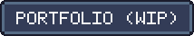

<!--
  ╔══════════════════════════════════════════════════════════════╗
  ║  CHEAT CODE ACCEPTED: you read the source. +1 life.          ║
  ║  Every pixel below is generated by scripts/build.py from a   ║
  ║  hand-rolled 5x7 bitmap font. No image editor was opened.    ║
  ║  More secrets: the HI score, the cron time, and three-letter ║
  ║  words a cat would type.                                     ║
  ╚══════════════════════════════════════════════════════════════╝
-->

<p align="center">
  
</p>

**Prajakta Jadhav** · third-year B.Tech CSE (AI) at VIT Pune · CGPA **9.07** · 1 patent filed · open to SDE / ML roles

<p align="center">
  <a href="https://policyiq.sanatanlabs.com/"></a>
  <a href="https://www.linkedin.com/in/prajakta-j-015324331"></a>
  <a href="mailto:jprajakta017@gmail.com"></a>
</p>

<br>




The HP bar is my actual CGPA and the level is my actual year. No stat on this page is a vibes-based percentage: you won't find "Python: 87%" here, because nobody knows what that means, including the people who write it.

<br>


### PolicyIQ · boss fight, cleared

**[▶ Play it live](https://policyiq.sanatanlabs.com/)** · **[Source](https://github.com/Praj24-04/POLICYIQ)**

Regulation is a dungeon with no map. PolicyIQ draws the map: it reads 934 regulatory and policy frameworks from 27 nations and turns them into a topology you can search, compare and get recommendations from.

| | |
|---|---|
| **My role** | Developer. Industry-sponsored. <!-- TODO(you): name the parts you built, e.g. "embedding pipeline, clustering, API" --> |
| **How it works** | Legal-BERT bi-encoders embed every framework → 50-D UMAP manifold → HDBSCAN density clustering → MS-MARCO cross-encoder re-ranking → MCDA recommendation engine. |
| **Status** | Deployed. Not a notebook, not a demo video. |

<!-- TODO(you): drop a screenshot or short GIF of PolicyIQ here. It is the single highest-value addition to this page.
     1. Save it as assets/policyiq.png (1200px wide is plenty; GIF under 5 MB).
     2. Uncomment the next line.
<p align="center"><a href="https://policyiq.sanatanlabs.com/"></a></p>
-->

<br>




- **1 · [PolicyIQ](https://github.com/Praj24-04/POLICYIQ)** · the one with the castle, see above.<br><sub>Python · Legal-BERT · UMAP · HDBSCAN</sub>
- **2 · [trojanMole](https://github.com/Praj24-04/trojanMole)** · a federated-learning testbed where one poisoned client teaches a skin-lesion model that melanoma plus a ruler equals "harmless mole". Then I build the defences that catch it.<br><sub>PyTorch · FastAPI · TypeScript</sub>
- **3 · [ss_graveyard](https://github.com/Praj24-04/ss_graveyard)** · your screenshots aren't a gallery, they're a graveyard. This digs them up with OCR and vision AI, works out why you saved them, and haunts you at the right time.<br><sub>React Native · Expo · Gemini</sub>
- **4 · [AR Try-On](https://github.com/Praj24-04/ASAP-ARVirtualTry-On)** · AR virtual try-on prototype. Your phone camera becomes the fitting room.<br><sub>Snap AR</sub>
- **5 · CIVIC-KALKI** · a metadata-driven civic operating system for transparent governance workflows. In progress; the cat is standing on it. <!-- TODO(you): add stack + repo link when it's public -->
- **? · Your team** · locked level. Needs a key that recruiters carry. [Unlock it](#save-point).

**Recently played** (auto-updated daily from my latest pushes):

<!--RECENT:START-->
- **[trojanMole](https://github.com/Praj24-04/trojanMole)** · last save `2026-11-01`<br><sub>A benchmark testbed for evaluating backdoor resilience and adversarial robustness in federated skin lesion vision models.</sub>
- **[ss_graveyard](https://github.com/Praj24-04/ss_graveyard)** · last save `2026-11-01`<br><sub>a graveyard is only creepy if nobody remembers who’s buried there! your screenshots aren't a gallery, they're a graveyard. lets dig them up, read them with OCR + AI, figure out why you saved them, and let em haunt you at the right time;)</sub>
- **[POLICYIQ](https://github.com/Praj24-04/POLICYIQ)** · last save `2026-10-24`<br><sub>topological regulatory intelligence & MCDA recommendation engine. 934 global frameworks mapped across 27 nations via Legal-BERT bi-encoders, 50-D UMAP manifolds, HDBSCAN density clustering & MS-Marco cross-encoder attention.</sub>
<!--RECENT:END-->

<br>




Only items I've actually used in a shipped repo. The rest of the shop is still on my wishlist.

<br>




<sub>Shelf notes: the patent stays in a locked chest until the paperwork says otherwise. <!-- TODO(you): add title / application no. when shareable --> The IEEE CS Global Student Challenge 2026 medal is for a boss my team didn't beat; <a href="https://github.com/Praj24-04/GSC26-Challenge3-004">the repo</a> stays public anyway. The fourth pedestal is not a rendering bug.</sub>
<!-- TODO(you): new win? Replace the "???" entry in data/profile.json "trophies" and run python3 scripts/build.py -->

<br>




This board is not a third-party widget. A [workflow](.github/workflows/arcade.yml) queries the GitHub GraphQL API every night, a [Python script](scripts/build.py) redraws the SVG pixel by pixel, and the bot commits it. It runs at 02:47 IST, for reasons my commit history can explain.

<picture>
  <source media="(prefers-color-scheme: dark)" srcset="assets/arcade/snake-dark.svg">
  
</picture>

### Hall of fame · insert a coin



Every arcade cabinet lets you leave your initials, so this one does too. **[Insert coin](https://github.com/Praj24-04/Praj24-04/issues/new?title=INSERT+COIN:+AAA&body=Change+AAA+in+the+title+to+your+three+initials+%28letters+or+digits%29,+then+press+Submit.+A+GitHub+Action+adds+you+to+the+board+and+closes+this+issue.)**, change `AAA` to your three initials, submit. A GitHub Action validates the entry, engraves you on the board within a minute, and replies. Some initials unlock a secret.

<p align="center">
  <a href="https://github.com/Praj24-04/Praj24-04/issues/new?title=INSERT+COIN:+AAA&body=Change+AAA+in+the+title+to+your+three+initials+%28letters+or+digits%29,+then+press+Submit.+A+GitHub+Action+adds+you+to+the+board+and+closes+this+issue."></a>
</p>

<br>


What I do when the main quest is compiling.

| Side quest | Field notes |
|---|---|
| 🧁 **Baking** | The only pipeline I run where a failed build is still edible. Brownies are my most reproducible result. |
| 🎨 **Painting** | A rendering engine with no undo. Every brushstroke is a force-push to main. |
| 📷 **Photography** | I take photos on purpose. The 4,000 screenshots are a separate issue (see level 3). |
| 🎤 **Public speaking** | I can explain federated learning to a room without one slide of equations. Stage fright was patched in an early release. |

<!-- TODO(you): a small gallery makes this section. Add up to 3 images (a bake, a painting, a photo) to assets/gallery/
     and uncomment:
<p align="center">
  
  
  
</p>
-->

<details>
<summary>💾 <code>MEMORY CARD · SLOT 2 · corrupted data, do not open</code></summary>

<br>

```text
> LOADING SLOT 2 ...
> CHECKSUM MISMATCH. LOADING ANYWAY, YOU SEEM NICE.

  PLAYTIME ............ mostly between 23:00 and 02:47
  LAST WORDS .......... "just one more test run" (it was not one)
  DEATHS .............. 1 x IEEE finals, 37 x CORS, 0 x giving up
  HI SCORE 934027 ..... 934 frameworks, 27 nations. Now you know.
  1P SCORE 009070 ..... it's the CGPA. It was always the CGPA.
  COMPANION ........... BISCUIT, sous-chef. Makes biscuits. Is a cat.
  UNLOCKABLE .......... sign the hall of fame as CAT, MEW or BUG
```

You opened the slot marked "do not open". We would get along. [Say hi](#save-point).

</details>

<br>

<a name="save-point"></a>


Progress saved. This is the part where you write to me before the next cutscene.

<p align="center">
  <a href="https://www.linkedin.com/in/prajakta-j-015324331"></a>
  <a href="mailto:jprajakta017@gmail.com"></a>
  <!-- TODO(you): when the portfolio is live, wrap this image in <a href="https://YOUR-SITE"> ... </a> and change the label in data/profile.json -->
  
</p>

<p align="center"><sub><a href="mailto:jprajakta017@gmail.com">jprajakta017@gmail.com</a> · portfolio level under construction, the cat is supervising</sub></p>

<br>




<sub>
<b>Directed, programmed, baked by</b> Prajakta Jadhav · <b>Sous-chef</b> Biscuit (original pixel cat, works for treats) ·
<b>Engine</b> dependency-free Python that draws every screen as SVG (<a href="scripts/">scripts/</a>) ·
<b>Palette</b> Sweetie-16 by GrafxKid · <b>Snake</b> <a href="https://github.com/Platane/snk">Platane/snk</a> ·
<b>Not used</b> anyone else's characters, sprites or logos.
</sub>
